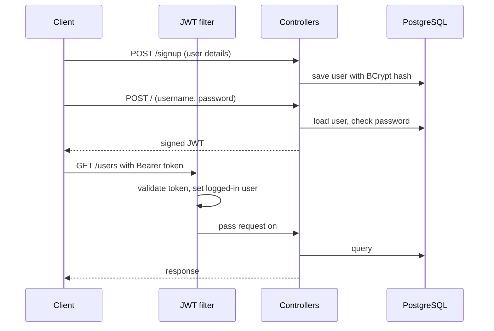

# User Authentication using Spring Security

[](https://github.com/immanoj22/User-authentication-using-spring-security/actions/workflows/build.yml)

A small Spring Boot app where users sign up and log in, and get back a JWT that they send on later requests. I built it to learn how Spring Security works with a custom JWT filter and a database-backed user store.

## What it does

- Sign up with name, username, email, phone number and password. Passwords are hashed with BCrypt (strength 12) before saving.
- Log in with username and password and receive a signed JWT.
- A filter reads the `Authorization: Bearer <token>` header, checks the token and sets the logged-in user for that request.
- Everything except sign-up and login needs a valid login (token, form login or HTTP basic).

## How it works



## Tech stack

Java 17, Spring Boot 3.4.1, Spring Security, Spring Data JPA, PostgreSQL, JJWT 0.12.5, Maven.

## Project layout

The code is in `Securty-authentication/` (the folder name has that spelling). Packages are split into `Controller`, `Service`, `Repository`, `Model`, `Configuration` and `JWTfilterconfiguration`.

## Running it locally

You need JDK 17 and PostgreSQL.

1. Create a database named `USER`.
2. In `Securty-authentication/src/main/resources/application.properties`, set your own database username and password (`your_password`).
3. The config does not set `ddl-auto`, so Hibernate will not create the `users` table for you. Either add `spring.jpa.hibernate.ddl-auto=update` or create the table yourself.
4. Start the app:

```
cd Securty-authentication
./mvnw spring-boot:run
```

It runs on the default port 8080.

## Endpoints

- `POST /signup` creates a user from a JSON body
- `POST /` logs in with `username` and `password` in JSON and returns the token as plain text
- `GET /users` lists all users (needs a token)
- `GET /home` returns a welcome message (needs a token)

## Notes

This is a learning project. The JWT signing key is generated randomly each time the app starts, so tokens stop working after a restart. Tokens expire after about 108 seconds because of how the expiry is calculated, which I would change to a configurable value. Next I would add duplicate checks on signup and stop `/users` from returning password hashes. There are no real tests, only the default context test.

Set `DB_PASSWORD` in your environment for the database password.
